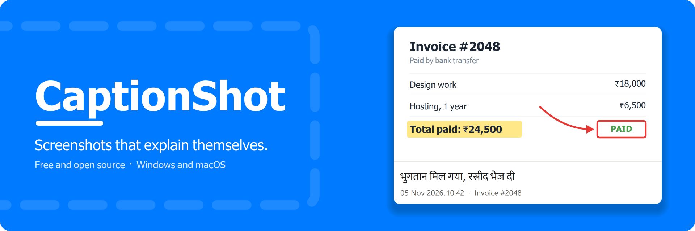

<p align="center">
  
</p>

<p align="center">
  <a href="https://github.com/alokstates/captionshot/releases/latest"></a>
  <a href="https://github.com/alokstates/captionshot/actions/workflows/build.yml"></a>
  
  <a href="LICENSE"></a>
</p>

<p align="center">
  <a href="#install">Install</a> ·
  <a href="#features">Features</a> ·
  <a href="#privacy">Privacy</a> ·
  <a href="#run-or-build-from-source">Build</a> ·
  <a href="CONTRIBUTING.md">Contribute</a>
</p>

CaptionShot is a free, open-source screenshot tool that lives in your system tray or menu bar. Press the hotkey, mark up the screen, add a caption, then save or copy the result.

## Install

Open a terminal and paste one line. You don't need Python. Run the same line again to update.

**Windows** (PowerShell):

```powershell
irm https://raw.githubusercontent.com/alokstates/captionshot/main/install.ps1 | iex
```

**macOS** (Terminal):

```bash
curl -fsSL https://raw.githubusercontent.com/alokstates/captionshot/main/install.sh | bash
```

| | Windows | macOS |
|---|---|---|
| **Hotkey** | Print Screen | Cmd+Shift+2 |
| **Installs to** | `%LocalAppData%\Programs\CaptionShot` | `/Applications` (or `~/Applications`) |
| **Settings** | `%APPDATA%\CaptionShot` | `~/.config/CaptionShot` |
| **Admin rights** | Not needed | Not needed |

<details>
<summary><b>What to expect on Windows</b></summary>

The install command sets CaptionShot to start when you sign in, and makes the Print Screen key open it instead of Snipping Tool. To give the key back, turn on *Use the Print Screen key to open screen capture* in Windows Settings > Accessibility > Keyboard.

The app isn't code-signed, so a setup file downloaded through a browser may show "Windows protected your PC". Choose More info > Run anyway.
</details>

<details>
<summary><b>What to expect on macOS</b></summary>

The first capture asks for Screen Recording permission. Turn on CaptionShot in System Settings > Privacy & Security > Screen & System Audio Recording, then quit and reopen it. Because the app isn't notarized by Apple, macOS may ask for this again after an update.

Use the terminal command above to install, because macOS blocks a copy downloaded through a browser.
</details>

## Features

- **Mark up:** pen, line, arrow, rectangle, oval, marker and text, each with its own size
- **Caption bar:** add a caption below the screenshot, with an optional date and window-title stamp
- **Hindi typing:** type in Hinglish and get Hindi, with suggestions that learn the words you pick
- **Several shots at once:** collect screenshots and combine them into one image
- **Your way:** choose your own hotkey and save folder, and copy or save with one key

## Privacy

CaptionShot has no accounts, analytics or ads, and your screenshots aren't uploaded. There are two things to know:

- **Hindi typing** is off until you turn it on. While it's on, each word you type in a caption is sent to Google's Input Tools service for suggestions.
- **The caption stamp** is on by default and adds the active window's title to the image. Check it before sharing, or turn it off in settings.

Read the full [Privacy Policy](PRIVACY.md).

## Uninstall

**Windows:** Settings > Apps > CaptionShot > Uninstall.

**macOS:**

```bash
pkill -x CaptionShot; rm -rf /Applications/CaptionShot.app ~/Applications/CaptionShot.app ~/Library/LaunchAgents/com.captionshot.agent.plist
```

Your settings stay in place, so a reinstall keeps them. To remove them too, delete the settings folder listed above.

## Run or build from source

You need Python 3.10 to 3.15.

```bash
python -m pip install -r packaging/requirements-build.txt
python captionshot.py
```

- **Windows installer:** run `build.bat`. The result is `dist\CaptionShot-Setup-<version>.exe`.
- **macOS app:** run `./build.sh`. The result is `dist/CaptionShot.app` and a zip of it.

Both build in a private `.venv-build` folder and run the packaged app's self-test.

<details>
<summary><b>Publishing a new version</b></summary>

1. Change the version in `captionshot.py` (`APP_VERSION`), `packaging/CaptionShot.iss`, `packaging/version_info.txt` and `build.bat`.
2. Commit, then tag and push:

   ```bash
   git tag v1.2.3
   git push origin main --tags
   ```

GitHub Actions builds both platforms, publishes the release and tests the install commands on clean Windows and Mac machines.
</details>

## Contributing

CaptionShot is built in public, and bug reports, ideas and pull requests are all welcome. Start with the [contributing guide](CONTRIBUTING.md). To report a security problem, see [SECURITY.md](SECURITY.md).

## Legal

Copyright © 2026 alokstates. Released under the [MIT License](LICENSE).

[Privacy Policy](PRIVACY.md) · [Terms of Use](TERMS.md) · [Third-party notices](NOTICE.md)
